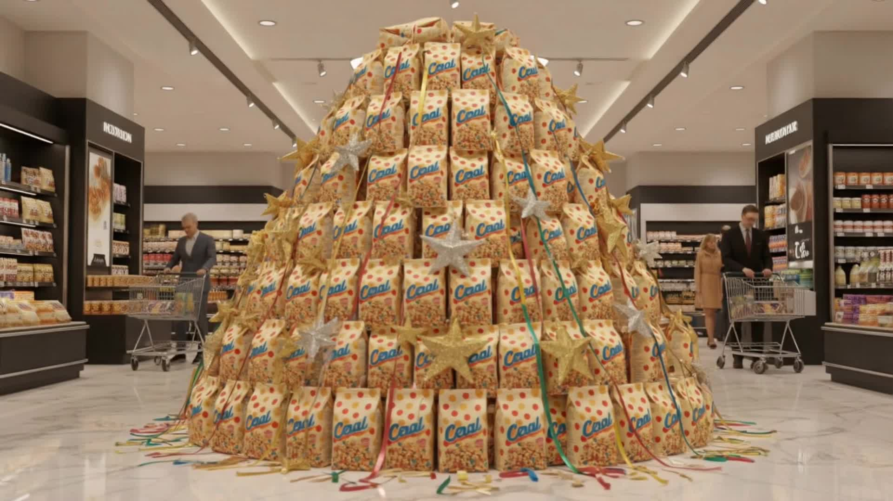

# How to Make a Supermarket Product Commercial With AI

[Watch demo MP4](https://data.pixwit.ai/video-effects/demos/supermarket-ad.mp4)

<video controls playsinline src="https://data.pixwit.ai/video-effects/demos/supermarket-ad.mp4"></video>

For packaged goods, the supermarket shelf is where the real battle happens. A clip that shows your product in a store setting speaks directly to shoppers. [Pixwit's Supermarket AD effect](https://pixwit.ai/video-effects/supermarket-ad) belongs to the product-ad family, which the page describes as making a pack shot feel like a commercial without a crew. 3D Naked-Eye AD and Package Explosion are named as related looks.

## Form details

When checked:
- Image upload (JPG, PNG, WebP up to 10MB), library, or public URL
- Resolution and duration settings
- Negative prompt
- Generate at 80 credits

## Place as a selling point

The page lists four things product-ad presets sell: transparency (a 360 spin), scale (a giant product), place (beach, ocean, supermarket) and craft (mechanical assembly). Supermarket AD falls under place: it puts your product where people buy it.

Watch the sample preview to see the exact scene before generating.

## Products that suit a store setting

- **Snacks and drinks**
- **Household cleaning products**
- **Personal care items**
- **Pet food**
- **Packaged frozen goods**

Luxury items, like fine jewelry, usually suit studio-style effects better.

## Preparing the pack shot

The page's advice: a clean pack or bottle shot, not a selfie.

1. Plain background, preferably white
2. Product upright, label facing forward
3. Even, bright lighting
4. Sharp focus on text
5. Whole product visible

## Accuracy and retail claims

A supermarket setting implies availability. Don't use it to suggest your product is stocked in a store where it isn't. If you are only online, consider captions like "Imagine it on every shelf" or choose a different preset.

Also avoid showing real retailer logos or competitor products in your edit.

## The page's realistic view

According to the page, high-end visual effects studios still win on complex shots like liquid simulations. These presets win on speed and cost for mid-funnel ads and small shops, and the page describes the result as impressive for a feed rather than a big-budget broadcast spot.

## Ad structure

| Seconds | Content |
|---|---|
| 0–5 | Supermarket AD clip |
| 5–7 | Real product close-up |
| 7–9 | Where to buy and offer |

## Checking the result

- Is the label accurate and readable?
- Are colors true to the product?
- Do other shelf items look generic, without real brands?

Use the negative prompt for "distorted label, other brand logos, extra text."

## Cost

At 80 credits per run, you can test a few products or angles cheaply.

## Comparing product-ad presets

| Effect | Selling point |
|---|---|
| Supermarket AD | Place: retail shelf |
| Package Explosion | Contents burst out |
| 3D Naked-Eye AD | Billboard illusion |
| Beach AD | Place: beach |

## Summary

Supermarket AD puts a clean pack shot into a retail setting for a quick product commercial. Watch the preview, keep labels accurate, avoid implying store availability you don't have, and follow with real product footage. More effects at https://pixwit.ai.

---

**Product:** [Pixwit](https://pixwit.ai) · Effect: [Supermarket Ad](https://pixwit.ai/video-effects/supermarket-ad)
